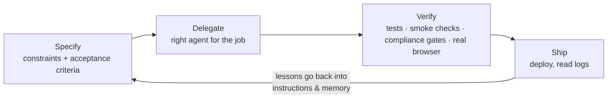
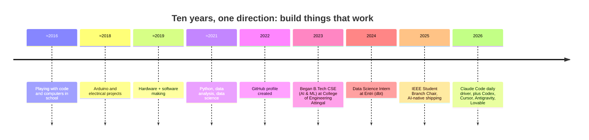

 

## Hi, I'm Siva 👋

I started building in school: **Arduino boards, electrical tinkering, small hardware**, and moved through software, **data analysis and data science** into full-stack engineering. About **ten years in**, I now ship products with a toolchain of AI coding agents, and I care as much about *proving the code works* as I do about writing it quickly.

📍 Thiruvananthapuram, Kerala, India · 🎓 **B.Tech CSE (AI & ML)** at College of Engineering Attingal (since 2023) · 🔎 Open to **AI engineering, full-stack and data roles** and internships

## ⚡ At a glance

| | |
|---|---|
| **10+ years** | building: school-era tinkering → hardware → software → data → AI products |
| **7+ months** | with **Claude Code** as my daily driver |
| **5 AI coding tools** | Claude Code · Codex · Cursor · Antigravity · Lovable, each with a defined job |
| **16 months** | as IEEE Student Branch Chair (Feb 2025 – May 2026), now Mentor |
| **41** | public repositories: ML notebooks, hackathon builds, production sites |

## 🤖 How I work with AI

> Fast is easy. Trustworthy is the skill.

| Tool | Role in my workflow |
|---|---|
| **Claude Code** | Daily driver: architecture, multi-file work, debugging, shipping. Extended with skills, hooks, MCP servers and persistent memory |
| **Codex** | Independent second opinion on hard bugs and risky changes |
| **Cursor** | Tight, hands-on edit loops |
| **Antigravity** | Agent-first workflows; parallel exploration |
| **Lovable** | Idea → deployable UI draft in minutes, then hardened by hand |

## 🚀 Selected work

| Project | What it is | Stack |
|---|---|---|
| **[Horizons](https://tasks.sivakumarms.tech)** | Task + goal manager; one SQL function feeds a 7am brief Claude reads back to me daily | Next.js · Supabase · Postgres |
| **[Portfolio platform](https://sivakumarms.tech)** | WebGL portfolio with admin studio, Postgres content and a Razorpay flow backed by a payment test suite + route smoke test | Next.js 16 · React 19 · three.js · Drizzle |
| **Claude Desktop Pet** | Pixel mascot that reacts live to everything Claude Code is doing, via its hook system | Electron · Node |
| **Bilingual law-firm site** | English/Malayalam site, 51 static pages, with a script that fails the build on advertising-rule violations | Next.js · MDX · i18n |
| **Meesho reseller store** | Storefront + Razorpay + admin that turns paid orders into Meesho purchases | Next.js · Razorpay · Drizzle |
| **[ISOBAR · Will It Rain](https://github.com/SivaKumar-004/ISOBAR)** | Hackathon build, my most-forked repo | JavaScript · HTML |
| **[Saffron](https://github.com/SivaKumar-004/Saffron)** | 48-hour hackathon build | TypeScript |
| **[Salary](https://github.com/SivaKumar-004/Salary_prediction) / Diamond price / [Time-series](https://github.com/SivaKumar-004/Time_series_prediction)** | Prediction models with Streamlit front-ends | Python · pandas · scikit-learn |

## 🧰 Stack

## 🧭 Journey

## 🤝 Leadership

- **IEEE Student Branch Chair**, CEAL, 16 months (Feb 2025 – May 2026), now **Mentor**; previously chair of the IEEE SPS chapter
- **Junior Chief AI Officer**, Alchemy IEDC
- **Technical Lead**, FOSS Cell, College of Engineering Attingal
- Designed a Malayalam digital-marketing class for village farm and food founders

## 📫 Let's talk

**[Open the interactive profile →](https://profile.sivakumarms.tech)** · [anandhusiva1234@gmail.com](mailto:anandhusiva1234@gmail.com) · [LinkedIn](https://www.linkedin.com/in/siva-kumar-m-s-735a3a243/)
